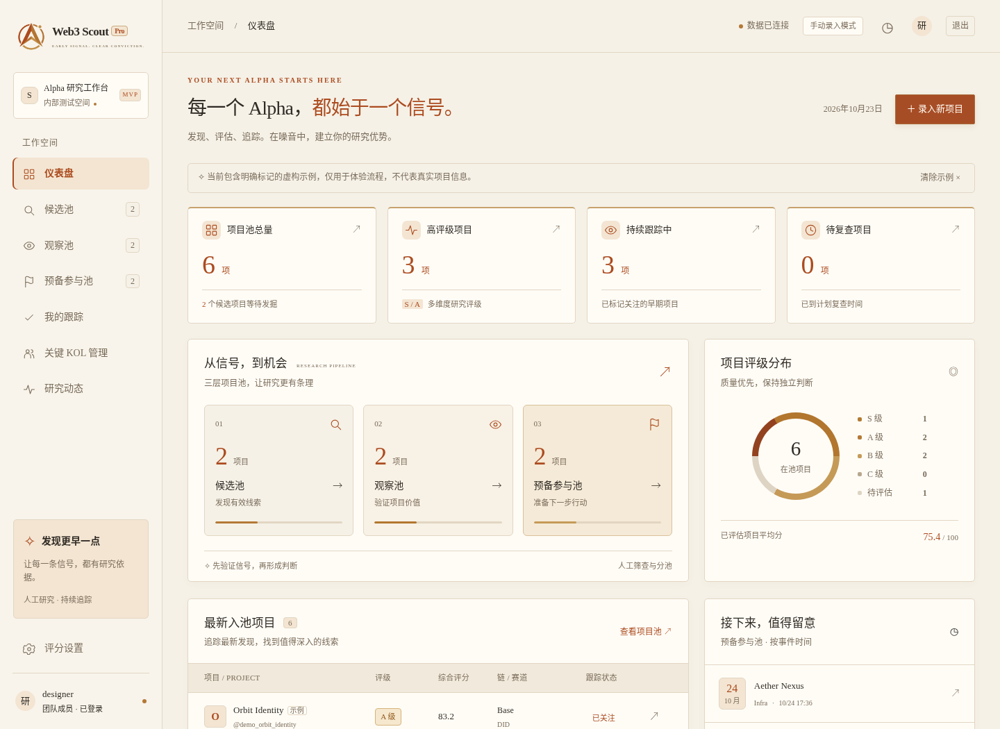

# Web3 Scout Pro

面向内部研究员的 Web3 早期 Alpha 项目研究工作台。根据产品文档实现，采用象牙白、赤金与黑 / 橙文字的团队研究界面，数据由人工录入，共享保存于服务端 SQLite，不依赖外部 API、Python 包或前端构建工具。

## 启动

需要 Python 3.12+。

```sh
cd /workspace/daxingongju
python3 server.py
```

默认监听 `127.0.0.1:3000`。`PORT`、`HOST`、`SCOUT_DB` 可覆盖端口、监听地址与数据库路径。页面与接口由同一服务提供。健康检查：`curl --fail http://127.0.0.1:3000/api/health`。

公网部署已补齐独立团队账号、scrypt 密码哈希、持久会话、退出与登录限流。部署使用 `SCOUT_REQUIRE_AUTH=1`，非回环地址监听时必须启用认证。详见 [公网部署说明](deploy/README.md)。默认本地开发仍使用回环地址且无需登录；团队账号均可编辑研究数据，暂没有细分角色。

## 内测流程

1. 在仪表盘点击“录入新项目”，填写名称与负责研究员。可直接“保存基础信息”，或继续补充信号和评分。
2. 记录链、赛道、X handle、官网、Mint 页面、发现来源、事件时间；项目名称与非空 X 账号做不区分大小写的去重。
3. 六个维度各填写 0–100 分，按 35/20/15/15/10/5 加权。任一维度缺失时不计算总分；真正的 0 分会保留。
4. S ≥85，A ≥70，B ≥50，C <50。S 还需至少两位不同的权重 ≥80 的 KOL 推广、转发或回复，否则为 A。人工评级需要填写原因，保留自动评级供对照。
5. 人工分池：候选、观察、预备参与、归档。预备参与必须填写事件时间，低于 A 或未评估时还需填写人工分池原因。
6. 详情中添加跟踪记录、变更“待研究 / 已关注 / 已参与 / 忽略”，或编辑项目。设定复查时间后，到期项目会计入仪表盘待复查指标。
7. 项目池支持名称 / 账号 / 叙事 / 研究员 / KOL 搜索，评级、链、赛道、状态筛选，更新时间 / 评分 / 事件时间排序，批量分池与关注，导出当前筛选结果的 CSV。
8. KOL 名单支持新增与移除，项目录入可引用其参考权重。原项目保存当时的信号权重快照，后续名单变更不篡改研究依据。
9. 评分设置支持调整六维权重，须合计 100%；保存后所有项目按新权重计算。研究动态保留最近 500 条操作和笔记的展示。

首次进入是真实空项目池。可主动载入 6 个**虚构示例**，界面逐项标记；“清除示例”仅移除带示例标记的项目，不移除真实录入。

## 数据

默认数据库 `.data/scout.db`（不进入 Git），不应删除它来刷新页面。SQLite WAL 支持服务进程内多请求共享数据。重启服务后保留项目、KOL、评分设置及动态。数据不经第三方服务。

备份示例（SQLite 在线备份接口）：

```sh
python3 - <<'PY'
import sqlite3
with sqlite3.connect('.data/scout.db') as source, sqlite3.connect('/tmp/scout-backup.db') as target:
    source.backup(target)
PY
```

当前编辑采用最后一次提交覆盖的方式，无并发冲突提示；适合小规模内部试用。删除项目不可从界面撤回，但保留相关操作记录。不要把手填的来源、链接、评分视为已被系统核实。

## 验证

```sh
python3 -m unittest discover -s tests -v
node --check web/app.js
# 可选：已安装 Playwright 和 /usr/bin/chromium 时运行独立浏览器验证
node tests/browser_smoke.cjs
node tests/auth_browser.cjs
```

后端集成测试使用临时数据库和随机端口，不改变内测数据。浏览器测试自行启动端口 3109 的独立临时数据库服务，结束后关闭并清理。覆盖持久化、评分门槛、去重、人工评级、预备参与约束、权重重算、跟踪记录、删除、链接验证、跨站写入拦截及示例清理。

详见 [首版产品梳理](docs/MVP.md)。

## 团队认证

本地创建账号：`python3 manage.py user-add alice`，密码在终端安全输入。`SCOUT_REQUIRE_AUTH=1 python3 server.py` 启用登录。生产环境必须使用 HTTPS，Cookie 默认带 Secure、HttpOnly 和 SameSite=Strict。仅本地 HTTP 验证可设置 `SCOUT_COOKIE_SECURE=0`。首次无人账号时，也可通过受保护进程环境的 `SCOUT_ADMIN_USERNAME` / `SCOUT_ADMIN_PASSWORD` 初始化；推荐使用终端命令，不在配置文件或聊天中存储密码。

部署用 Dockerfile 固定官方基础镜像摘要，以非 root 用户运行，持久卷保存 SQLite。部署脚本在服务器终端创建初始账号，不需要传递管理员密码到本环境。

## 界面主题

全站采用象牙白底色、赤金图标与标签、黑色正文和橙色重点文字。桌面、手机、登录页、项目详情、三步录入、KOL 与评分设置使用同一组颜色变量。

中文优先使用微软雅黑（Microsoft YaHei），英文及数字优先使用 Cambria，通过 Unicode 字符范围分别指定。字体使用浏览器所在设备的本地字体；缺少字体时分别回退到 Noto Sans CJK 和 Georgia / Liberation Serif，无外部字体请求。Windows 上已安装微软雅黑及 Cambria 时直接使用指定字体。



## 品牌标志

Logo 由 Alpha 的 A 形罗盘指针、环形追踪轨道和右上早期信号点组成，使用赤铜与金色，适配象牙白界面。透明底原始素材位于 `web/brand/scout-mark.png`，统一用于侧栏、手机导航、登录页、浏览器与触屏收藏图标。图片 URL 带内容版本号，便于更新时刷新缓存。


